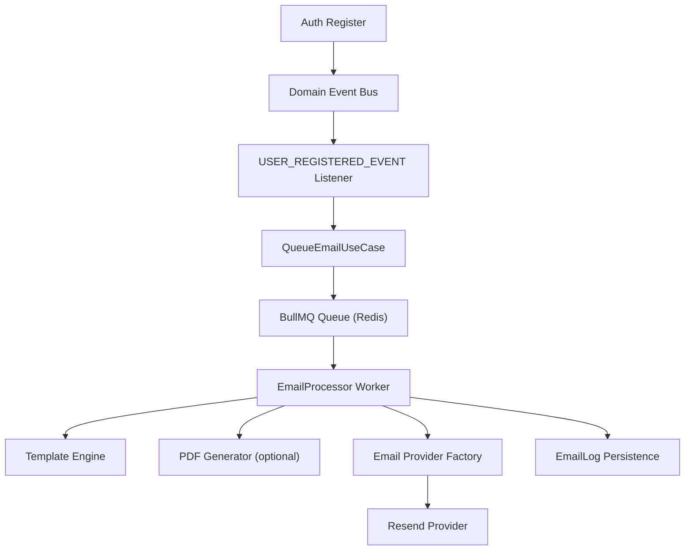

# Rakhal Email System

## Phase Tracker
- Phase 1 (Codebase Analysis): DONE
- Phase 2 (Email Core Design): DONE
- Phase 3 (Queue + Redis Setup): DONE
- Phase 4 (Factory + Resend Provider): DONE
- Phase 5 (Template System): DONE
- Phase 6 (Email Verification System): DONE
- Phase 7 (PDF System): DONE
- Phase 8 (Event Integration): DONE
- Phase 9 (Logging + Security): DONE
- Phase 10 (README Documentation): DONE

## Architecture Diagram

## System Flow
1. Auth registration creates user with `isEmailVerified=false`.
2. Auth emits `USER_REGISTERED_EVENT`.
3. Email listener creates verification token and queues `EMAIL_VERIFICATION`.
4. BullMQ worker processes job with retries and exponential backoff.
5. Template rendered from file-based templates.
6. Optional PDF attached for report/receipt workflows.
7. Provider factory resolves provider (`resend` default).
8. Email log lifecycle is persisted and logged.

## Redis + BullMQ Setup
- Start Redis locally:
  - `docker compose -f docker-compose.redis.yml up -d`
- Required env:
  - `REDIS_HOST`, `REDIS_PORT`, `REDIS_DATABASE`, `REDIS_PASSWORD` (optional)
- Queue defaults:
  - attempts: `5`
  - backoff: exponential (`1000ms` seed)
  - delayed jobs via `sendAt`

## Email Verification
- Endpoint: `POST /auth/verify-email` with `{ "token": "..." }`
- Token storage: `AuthToken` (`TokenType.EMAIL_VERIFICATION`)
- Verification updates:
  - `isEmailVerified=true`
  - `emailVerifiedAt=<timestamp>`
  - token marked `isUsed=true`

## PDF System
- Service: `PdfGeneratorService`
- Current support:
  - vaccination report
  - milk report
  - farm invoice
  - subscription receipt
- Implementation is server-side Node rendering (`pdfkit`) and queue attachment safe.

## Provider Factory
- `EmailProvider` interface
- `EmailProviderFactory` picks from:
  - `resend`
  - `smtp` (stubbed for future self-hosted SMTP)

## Logging System
- Uses existing `LoggerService` only.
- No `console.log`.
- Lifecycle logs include:
  - queued
  - worker picked
  - provider success
  - failure
  - retry
  - verification sent/verified
- Metadata fields:
  - `emailId`, `userId`, `tenantId`, `farmId`, `timestamp`, `correlationId`

## Use Cases
- Registration email verification
- Farm invitation email
- Cow vaccination reminder
- Subscription expiry warning
- Payment confirmation
- Farm PDF reports
